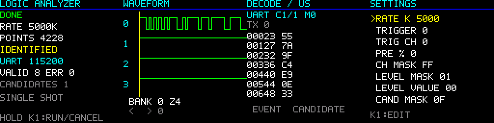

# FPGA2026 — FPGA 协议自识别逻辑分析仪

AMD 初级组 / 正点原子领航者 ZYNQ7010 / Vivado + SDK 2018.2。

本机主项目位置：`E:\FPGAproject\FPGA2026`。

8 路、32 KiB 环形采样缓存，1/5/10/25/50 MSa/s；立即、上升沿、下降沿、电平组合触发；0/25/50/75% 预触发；ARM 裸机分析 UART / I²C / SPI；128×128 SPI TFT 显示与双按键操作。

**这是首版工程源码。仿真、构建和上板状态请看 [验证记录](docs/VALIDATION.md)。未完成实际接线、屏幕型号核对和上板验收前，不把它视为已经验证的比赛成品。**

## 快速开始

在 PowerShell 中进入仓库目录：

```powershell
# 默认使用本机已发现的工具路径，可通过参数覆盖。
./scripts/test.ps1
./scripts/build.ps1 -Stage All
```

- `test.ps1`：编译运行可移植 C 分析器及界面测试；调用 XSim 验证 RTL；将 RTL 产生的 UART、I²C、SPI 四模式采样重新交给同一套 C 分析器验证。
- `build.ps1`：生成 block design、综合、实现、输出 bit/HDF，再构建 ARM ELF。
- 分阶段使用 `-Stage Project`、`Hardware`、`Software`。
- `-Vivado`、`-Sdk` 可覆盖安装路径；测试的 `-Gcc` 可指定 Windows GCC，`-HostOnly` 只运行 C 测试。
- 输出位于 `build/export/`。源代码不依赖已有 `.xpr`、其他人的生成文件或 2020.2 IP。

构建时临时用空闲 T:～Z: 映射仓库，结束后解除，以避开 2018.2 的 Windows 长路径问题。该过程不修改系统环境变量或删除工程文件。生成的工程引用这个短路径；直接用 Vivado 查看时需重新映射到构建时同一盘符，或在短目录下重新生成。

## 使用与文档

- [接线、屏幕配置和首次启动](docs/HARDWARE.md)
- [操作、串口命令、演示流程](docs/USER_GUIDE.md)
- [寄存器和软硬件接口](docs/INTERFACE.md)
- [验证结果与剩余事项](docs/VALIDATION.md)
- [架构、识别范围和局限](docs/ARCHITECTURE.md)



目录：`rtl/` 为 Verilog-2001；`firmware/` 为 ARM C 和可在电脑测试的分析器；`tests/` 为独立测试激励；`scripts/` 为重建、测试、调试入口；`constraints/` 为参考引脚约束。

## 实现选择

- 首版使用 Cortex-A9 的片内 OCM，不使用外部 DDR，减少对未经核实的 DDR 参数的依赖。
- 所有 PL 数据通路、AXI 控制和 BRAM 控制器共享板上 50 MHz 时钟；PS 自己的时钟域由官方 AXI 接口处理。异步输入有两级同步，复位由 `proc_sys_reset` 同步释放。
- 先完成一次采集，再分析和显示；循环模式也有分析／显示间隙。
- 自动识别最多搜索 4 路候选通道。SPI 模式、收发方向可能有歧义，界面会显示 `AMBIGUOUS`，可手动指定。
- 评分表示规则匹配程度，不是经过统计标定的概率。测试集通过不表示所有未知信号都能被正确识别。
- 屏幕按 SPI ST7735 系列暂定配置，型号、偏移、RGB/BGR 顺序需要实际核对。
- 当前启动方式为 JTAG 下载；断电启动需要后续核对板卡启动介质后另行制作，不自动写入 Flash。

## 参考资料

开发参考本机配套 FPGA 例程中的器件、时钟和引脚配置；未复制其带版权声明的 RTL。PS/AXI 使用 AMD 随 Vivado/SDK 提供的 IP 和驱动。ST7735 同类屏幕资料：[Waveshare 128×128 SPI 屏说明](https://www.waveshare.com/wiki/1.44inch_LCD_HAT)。实际屏幕未确认是该型号。
