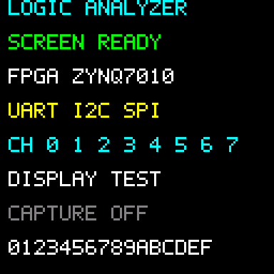

# ST7735S：ZYNQ7010独立PL文字显示恢复

五色基线在2026-10-30由用户确认花屏消失、全屏正常循环；当前在同一初始化和接线上恢复文字页，用户确认屏幕已有显示内容并要求保存。这是独立Verilog显示测试，使用领航者ZYNQ7010板载50MHz时钟，无需ARM应用。主工程现在通过AXI画布桥复用本目录的驱动，已单独确认界面及KEY0翻页；本目录仍保留独立显示测试入口。

当前标签：`st7735s-text-20261031`；文字版bit在`artifacts/`，SHA256：

```text
c021061ffc5c7c1d464985cac410ae1c8b8dd04e34cb2f8f2cc5ea245ae779e5
```

## 已验证配置

- 顶层`st7735s_top`，器件`xc7z010clg400-1`，Vivado2018.2。
- `INIT_PROFILE=2`保留STM32参考程序的77个初始化字节和逐字节CS行为。
- RES低100ms；RES释放到Sleep Out、Sleep Out到下一命令均等待150ms，修正参考C的两处50ms不足。
- 窗口偏移X=2、Y=3；全屏地址X=2..129、Y=3..130。原参考0/32曾造成顶部固定花屏。
- RGB565高字节先发，MSB先发，升沿采样；SCK普通位高/低各2µs，逐字节结束及间隔保持高。
- 初始化后打开背光，清黑屏并绘制文字。`DISPLAY_TEXT=1`默认文字，0保留五色循环。
- 当前文字bit不带ILA/VIO，**屏幕寄存器读取关闭**；未写入Flash，断电后需重新下载。

## 文字页面与范围

复用主工程`firmware/src/ui.c`的47个5×7字符字模，显示标题、屏幕状态、FPGA/协议名称、0..7通道编号与十六进制字符。页面标注`DISPLAY TEST / CAPTURE OFF`，没有伪装真实采集、触发或协议识别已经接入。

下面是由独立字模参考生成的电脑预览，不是实物照片：



五色标签`st7735s-fullscreen-20261030`保持不变；其bit/ltx、启动采样和报告同时保存在`artifacts/fullscreen_20261030/`。当前文字bit不要配用旧五色版的ltx。

## 接线

以内排靠板中央、外排靠PCB边缘定位J3，球位名称不是连接器针号。

| 屏幕 | 线色 | 开发板 |
|---|---|---|
| GND | 棕 | GND |
| VCC | 白 | 3.3V |
| SCL | 橙 | V17，J3内排 |
| SDA | 黄 | V18，J3外排 |
| RES | 绿 | Y18，J3内排 |
| DC | 蓝 | R18，J3外排 |
| CS | 紫 | T17，J3内排 |
| BLK | 灰 | Y19，J3外排 |

板载时钟U18，低有效PL复位N16。所有信号LVCMOS33；J3与并行RGB LCD共用IO。屏幕标记ST7735S、HD14008H14 JY，1.44寸128×128。

## 恢复已验证文件

在本目录打开PowerShell，保持原接线并连接JTAG：

```powershell
New-Item -ItemType Directory -Path build -Force | Out-Null
Copy-Item artifacts/st7735s_top.bit -Destination build
./scripts/program_jtag.ps1
```

下载脚本暂停两个ARM核，只临时配置PL并检查DONE/EOS。保持供电，约数秒后应出现静态文字页。恢复五色基线时复制`artifacts/fullscreen_20261030/`的配套bit/ltx，或切换对应Git标签。

## 从源码构建与检查

```powershell
./scripts/test.ps1
./scripts/test_text.ps1
./scripts/test_debug.ps1
./scripts/build.ps1
./scripts/program_jtag.ps1
```

默认Vivado/SDK路径为`E:\fpga\Vivado\2018.2`及`E:\fpga\SDK\2018.2`，可通过脚本参数覆盖。参考C对照需要Python和Windows GCC，默认GCC为`E:\DevC++\Dev-Cpp\MinGW64\bin\gcc.exe`。Python检查脚本的首个参数可覆盖GCC路径。普通构建不生成调试核；若要重新抓启动记录，使用`build.ps1 -DebugLcd`、下载后运行`capture_init.ps1`（默认验证黑色清屏，五色模式使用`-InitialColor F800`）。另加`-ReadPanel`才会启用历史可选LCD读回，当前不使用。

文字测试台从实际SPI字节重建LCD GRAM，对比全部16384像素，与独立C字模参考全部一致；包含清屏和1404个文字前景点。文字/VIO集成的150ms等待测试通过。文字普通构建WNS +9.478ns、WHS +0.122ns，TNS/THS=0；LUT440、寄存器177、BRAM0、DSP1；DRC无错误或严重警告，保留六项普通提示，报告在`artifacts/`。实际JTAG下载DONE/EOS=1，用户反馈屏幕已有内容。

实物反馈尚未逐项确认每个字符、方向、颜色或长期运行；真实逻辑分析仪数据仍需后续接入。历史排查记录见`BRINGUP_HISTORY.md`；其中本机绝对路径和早期失败状态保留为历史资料，当前使用本目录相对路径构建。

## 参考来源

`reference/stm32_csdn_original/`保留用户提供的原C参考与主机记录器；`reference/slow_gpio_0044/`保留此前GPIO实现。原文件编码及换行保留，测试桩不是完整STM32 HAL。芯片时序依据[ST7735S V1.1手册](https://files.waveshare.com/upload/e/e2/ST7735S_V1.1_20111121.pdf)9.17/10.1.8；用户提供的ST7735 V1.7中文翻译71/91页交叉确认相同等待要求。
